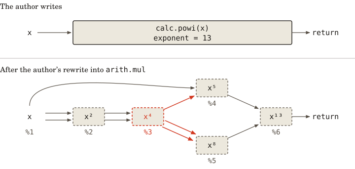
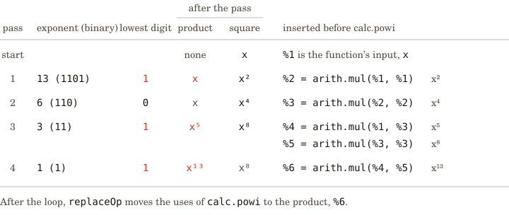
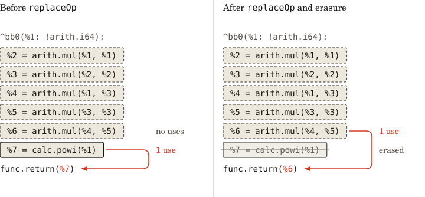
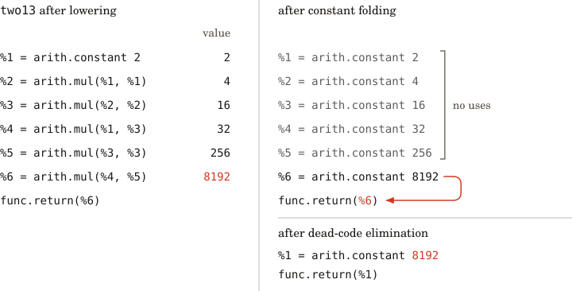

<p align="center">
  
</p>

- **Purpose:** Represents, checks, and transforms programs in compilers written
  in Zig.

Compilers for new languages and new hardware often rebuild the same machinery: a
way to represent programs, check them, transform them, and emit machine code.
The author of a new compiler should only have to write what is specific to their
language or device, and take the rest from a shared library.
[MLIR](https://mlir.llvm.org/) (a toolkit of shared compiler parts) made that
kind of reuse practical for compilers written in C++, on top of LLVM. Choir
provides the same infrastructure as a Zig library, with no LLVM or C++ toolchain
underneath, so a Zig program can carry its own compiler.

Choir represents a program as computations (_operations_) connected by their
inputs and results (_values_). Related operations and types belong to a
_dialect_. Compiler authors define operations for their languages and rewrite
them into operations that Choir already compiles.

## Install

The source archive is attached to the GitHub release, and `gh` downloads it:

```sh
gh release download v26.10.2 --repo a-tiny-project/choir --pattern 'choir-v26.10.2.tar.gz'
tar -xzf choir-v26.10.2.tar.gz
```

Choir builds with the official Zig 0.17.0 release. The extracted directory is a
Nix flake, and its default development shell supplies that compiler on x86_64
Linux and Apple silicon macOS. A project that depends on Choir builds with any
Zig 0.17.0, such as the one in that shell, and fetches the archive:

```sh
nix develop /path/to/choir-v26.10.2
zig fetch --save=choir /path/to/choir-v26.10.2.tar.gz
```

The project's `build.zig` then imports the `choir` module:

```zig
const choir = b.dependency("choir", .{ .target = target, .optimize = optimize });
const root = b.createModule(.{
    .root_source_file = b.path("src/main.zig"),
    .target = target,
    .optimize = optimize,
    .imports = &.{.{ .name = "choir", .module = choir.module("choir") }},
});
```

The archive holds the sources the `choir` module compiles, without their tests,
and a consumer program in `examples/consumer` that imports the module this way.
Before each release, that program builds and runs against the archive on x86_64
Linux and Apple silicon macOS.

## Use

Consider a compiler for formulas such as `x^13`. Multiplying thirteen copies of
`x` takes twelve multiplications, but the compiler can reuse intermediate
powers. Squaring three times gives `x^2`, `x^4`, and `x^8`, and two more
multiplications combine `x`, `x^4`, and `x^8`: five in all.

The formula language represents the power as one operation, `calc.powi`, with an
input `x` and an exponent fixed at compilation. The `calc` dialect holds the
operations of this example language, and Choir's `arith` dialect supplies shared
arithmetic operations. The compiler author supplies a rewrite from `calc.powi`
to `arith.mul`. Choir can then compile those multiplications or evaluate them
when the input is known.

The rewrite produces the graph below. `x^4` feeds two multiplications, including
both inputs of the squaring that produces `x^8`. Printed names such as `%1` and
`%2` identify values, beginning with the input `x`.

<p align="center"></p>

_Top, the author's function contains one `calc.powi` (solid outline). Bottom,
five `arith.mul` operations share intermediate powers (dashed outlines), with
printed value names below them. Each arrow is one operand: `%3` (`x^4`), in red,
supplies three operands to two multiplications._

The example below is a compiler in four Zig files. Each listing contains a
complete module and imports its dependencies. In the release archive's
`examples/consumer`, save the listings under `src/` with the filenames shown,
replacing `src/main.zig`. From the archive root, the following command builds
and runs the program. It uses 64-bit integers, with inputs whose powers fit in
that type.

```sh
zig build --build-file examples/consumer/build.zig run
```

The first module defines the language's power operation:

```zig
// calc.zig
const choir = @import("choir");
const ir = choir.ir;

pub const CalcDialect = struct {
    pub const name = "calc";
    const templates = ir.dialects.operationTemplate.dialect(@This());
    pub const spec = ir.dialects.dialectSpec(@This(), .{});

    pub const PowOp = struct {
        op: *ir.Operation,

        pub const leaf = templates.explicitLeaf(@This(), .{
            .mnemonic = "powi",
            .operands = .{"base"},
            .results = .{"result"},
            .required_attrs = .{ir.dialects.attribute.integer("exponent")},
            .interfaces = &.{ir.dialects.opSpec.verifier(verifyPow)},
        });
        pub const operation_name = leaf.operation_name;

        pub fn create(context: *ir.Context, base: *ir.Value, exponent: i64) !PowOp {
            const pow = try leaf.createLeaf(
                context,
                .unknown,
                &.{base},
                &.{base.type},
            );
            try leaf.setI64Attr(pow, "exponent", exponent);
            return pow;
        }

        pub fn getBase(self: PowOp) *ir.Value {
            return leaf.getOperand(self, "base");
        }

        pub fn getExponent(self: PowOp) i64 {
            return leaf.getI64Attr(self, "exponent").?;
        }

        pub fn getResult(self: PowOp) *ir.Value {
            return self.op.getResult(0).?;
        }
    };
};

/// The verifier rejects an exponent below one, which the rewrite does not handle.
fn verifyPow(op_ptr: *const anyopaque) anyerror!void {
    const op: *ir.Operation = @ptrCast(@alignCast(@constCast(op_ptr)));
    const pow = CalcDialect.PowOp{ .op = op };
    if ((CalcDialect.PowOp.leaf.getI64Attr(pow, "exponent") orelse 0) < 1)
        return error.ExponentBelowOne;
}
```

The declaration describes the operation's structure: one input, one output, and
an integer attached to the operation, called an _attribute_, which holds the
exponent. `verifyPow` checks that the exponent is positive. The rewrite gives
the operation its meaning.

## Lowering a power

A rewrite builds a replacement computation and connects it to the rest of the
program. To expand `x^13`, it repeatedly squares `x` and multiplies the powers
selected by the binary representation of 13: `8 + 4 + 1`. Rewriting an operation
into operations that another compiler stage handles is called _lowering_.

The complete program builds a function named `power13`, which passes its input
to `calc.powi` and returns the result. The next module imports the operation
definition and registers its rewrite. `applyPatternsGreedily` applies the
rewrite throughout the module, which contains the functions being compiled. A
`PatternRewriter` inserts the new operations and replaces the old result. The
`multiply` helper creates one `arith.mul` and inserts it before the power
operation.

Testing `exponent & 1` selects a power when the exponent's current lowest binary
digit is one. The first selected power becomes the product, and later selected
powers multiply into it. Shifting right moves to the next digit:

```zig
// lower.zig
const std = @import("std");
const choir = @import("choir");
const ir = choir.ir;
const arith = choir.dialects.ArithDialect;
const CalcDialect = @import("calc.zig").CalcDialect;

fn lowerPow(
    op: *ir.Operation,
    rewriter: *ir.rewrite.PatternRewriter,
) ir.rewrite.PatternResult {
    lowerPowOrFail(op, rewriter) catch return .failure;
    return .success;
}

fn lowerPowOrFail(op: *ir.Operation, rewriter: *ir.rewrite.PatternRewriter) !void {
    const pow = CalcDialect.PowOp{ .op = op };
    const context = op.getContext();
    rewriter.setInsertionPointBefore(op);

    var exponent = pow.getExponent();
    var square = pow.getBase();
    var product: ?*ir.Value = null;
    while (true) {
        if (exponent & 1 == 1) {
            product = if (product) |partial|
                try multiply(context, rewriter, partial, square)
            else
                square;
        }
        exponent >>= 1;
        if (exponent == 0) break;
        square = try multiply(context, rewriter, square, square);
    }
    try rewriter.replaceOp(op, &.{product.?});
}

fn multiply(
    context: *ir.Context,
    rewriter: *ir.rewrite.PatternRewriter,
    lhs: *ir.Value,
    rhs: *ir.Value,
) !*ir.Value {
    const mul = try arith.MulOp.create(context, .unknown, lhs, rhs);
    _ = try rewriter.insert(mul.op);
    return mul.getResult();
}

pub fn lower(allocator: std.mem.Allocator, module: *ir.Operation) !void {
    const context = module.getContext();
    var patterns = ir.rewrite.RewritePatternSet.init(allocator);
    defer patterns.deinit();
    try patterns.add(ir.rewrite.RewritePattern.init(.{
        .name = "calc-powi-to-arith",
        .root_op_name = CalcDialect.PowOp.operation_name,
    }, lowerPow));
    const rewritten = choir.passes.applyPatternsGreedily(
        allocator,
        context,
        module,
        &patterns,
        .{},
    );
    if (rewritten.termination != .converged) return error.RewriteDidNotConverge;
}
```

The four passes below trace this loop for exponent 13, using the same value
names as the graph above.

<p align="center"></p>

_The table shows the product and square after each pass. A one bit selects a
power for the product (red). The first selected power becomes the product, and
later powers multiply into it. Four passes insert five multiplications._

Each computed value has one definition (_static single assignment_, or SSA), and
Choir records every use of it. Because those uses are recorded, `replaceOp` can
redirect every use of the original power's result to the new result. For
`power13`, that use is the function's return value. The rewrite driver then
erases the old operation, whose result is no longer used.

<p align="center"></p>

_Left, the new multiplications have been inserted, but the return still uses the
power's result, `%7`. Right, `replaceOp` has redirected that use to `%6` (red),
and the rewrite driver has erased `calc.powi`._

## Knowing the input during compilation

A formula whose input is fixed, such as `2^13`, can be evaluated before the
compiled function runs. The example builds a second function, `two13`, whose
base is the constant `2`. The same rewrite first produces five multiplications.
Choir's _constant folding pass_ (a transformation that evaluates operations on
known inputs) replaces them with constants, and a second pass removes operations
whose results are unused:

```zig
// simplify.zig
const std = @import("std");
const choir = @import("choir");

pub fn simplify(allocator: std.mem.Allocator, module: *choir.Operation) !void {
    var passes = choir.PassManager.init(allocator);
    defer passes.deinit();
    passes.enableVerifier();
    try passes.addPass(choir.passes.createConstantFoldingPass());
    try passes.addPass(choir.passes.createDeadCodeEliminationPass());
    if (passes.run(module, module.getContext()) != .success) return error.PassFailed;
}
```

<p align="center"></p>

_Left, `two13` after lowering. Upper right, folding has replaced the
multiplications with constants. Only `8192` reaches the return (red), leaving
five unused constants (faded). Lower right, dead-code elimination has removed
those constants, leaving `8192` and the return._

The resulting function returns the constant `8192`. The arithmetic dialect
provides both the meaning of multiplication and the fact that it has no other
effects, so replacing its result also replaces everything the operation does. By
lowering into that dialect, the formula compiler reuses its existing
optimizations.

`enableVerifier` checks the program's structure and each dialect's rules after a
pass. Tests of the resulting function check the rewrite's meaning: a
structurally valid rewrite can still compute the wrong power.

## Compiling the result

The final module puts the compiler together. A `Context` owns the shared types
and attributes. Registering Choir's dialects and the example's `calc` dialect
with this context makes their operation definitions available for construction
and verification. `addPower` builds a function from its input, power operation,
and return. A `null` base leaves the input for the caller to supply, while a
fixed base becomes a constant in the function body.

After lowering and simplification, the functions use operations that Choir's
native code generator handles. An in-process compiler (a _just-in-time
compiler_, or JIT) turns them into machine code. `getFunction` returns a
function pointer with the specified Zig type. Calls must occur before
`runtime.deinit`, which releases the compiled code. Contexts and runtimes take
fixed memory capacities. `.testing` selects the small capacities used by Choir's
tests:

```zig
// main.zig
const std = @import("std");
const choir = @import("choir");
const arith = choir.dialects.ArithDialect;
const func = choir.dialects.FuncDialect;
const Builtin = choir.dialects.BuiltinDialect;
const CalcDialect = @import("calc.zig").CalcDialect;
const lower = @import("lower.zig").lower;
const simplify = @import("simplify.zig").simplify;

fn addPower(
    context: *choir.Context,
    module: *choir.Operation,
    name: []const u8,
    base: ?i64,
) !void {
    const integer = try arith.getScalarType(context, .i64);
    const inputs: []const choir.Type = if (base != null) &.{} else &.{integer};
    const function = try func.FuncOp.create(
        context,
        .unknown,
        name,
        inputs,
        &.{integer},
    );
    const block = function.getEntryBlock();
    const x = if (base) |value| blk: {
        const constant = try arith.ConstantOp.createInt(
            context,
            .unknown,
            integer,
            value,
        );
        try block.addOperation(constant.op);
        break :blk constant.getResult();
    } else function.getArgument(0);
    const power = try CalcDialect.PowOp.create(context, x, 13);
    try block.addOperation(power.op);
    const ret = try func.ReturnOp.create(context, .unknown, &.{power.getResult()});
    try block.addOperation(ret.op);
    const body = (Builtin.ModuleOp{ .op = module }).getBodyBlock();
    try body.addOperation(function.op);
}

pub fn main(init: std.process.Init) !void {
    const allocator = init.gpa;
    var context = try choir.Context.init(allocator, choir.Context.Limits.testing);
    defer context.deinit(allocator);
    try choir.dialects.registerAllDialects(&context);
    try choir.ir.dialects.loadDialectSpec(&context, CalcDialect.spec);
    const module = (try Builtin.ModuleOp.create(&context, .unknown)).op;
    defer module.erase();
    try addPower(&context, module, "power13", null);
    try addPower(&context, module, "two13", 2);
    try choir.ir.verifyOperation(module, .{});
    try lower(allocator, module);
    try simplify(allocator, module);

    var buffer: [4096]u8 = undefined;
    var stdout = std.Io.File.stdout().writer(init.io, &buffer);
    const out = &stdout.interface;
    const Runtime = choir.backends.execution.native.Runtime;
    if (!Runtime.available) {
        try out.writeAll("Native execution is unavailable on this host.\n");
        return out.flush();
    }
    var runtime = try Runtime.init(allocator, .testing);
    defer runtime.deinit();
    const handle = try runtime.compile(module);
    const Power = *const fn (i64) callconv(.c) i64;
    const Constant = *const fn () callconv(.c) i64;
    const power13 = try runtime.getFunction(handle, "power13", Power);
    const two13 = try runtime.getFunction(handle, "two13", Constant);
    try out.print("power13(3) = {d}\ntwo13() = {d}\n", .{
        power13(3), two13(),
    });
    try out.flush();
}
```

On x86-64 Linux, the program prints:

```text
power13(3) = 1594323
two13() = 8192
```

The compiler author wrote the power operation and its rewrite. Choir supplied
the arithmetic operations, simplified the constant expression, generated the
machine code, and loaded the compiled functions.

## Limits

The example's default native runtime executes generated code on x86-64 Linux. It
checks `Runtime.available` before compiling or calling machine code and reports
when execution is unavailable. The program construction, rewriting, and constant
folding precede that guard.

## Code

- [Public namespace](src/root.zig)
- [Operations, blocks, regions, values and Context](src/core/root.zig)
- [Core dialects and registration](src/dialects/root.zig)
- [Transformations and conversion](src/passes/root.zig)
- [Native compilation and execution](src/backends/execution/root.zig)
- [Build](build.zig)

## References

Choir borrows MLIR's representation and dialect design.

- Chris Lattner et al.,
  [MLIR: Scaling Compiler Infrastructure for Domain Specific Computation](https://research.google/pubs/mlir-scaling-compiler-infrastructure-for-domain-specific-computation/),
  CGO 2021.

## License

AGPL-3.0-or-later. See [LICENSE](LICENSE).
